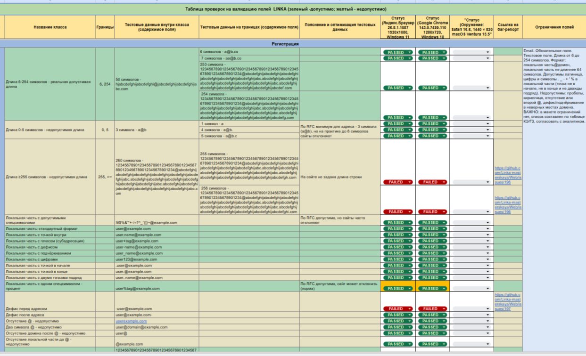
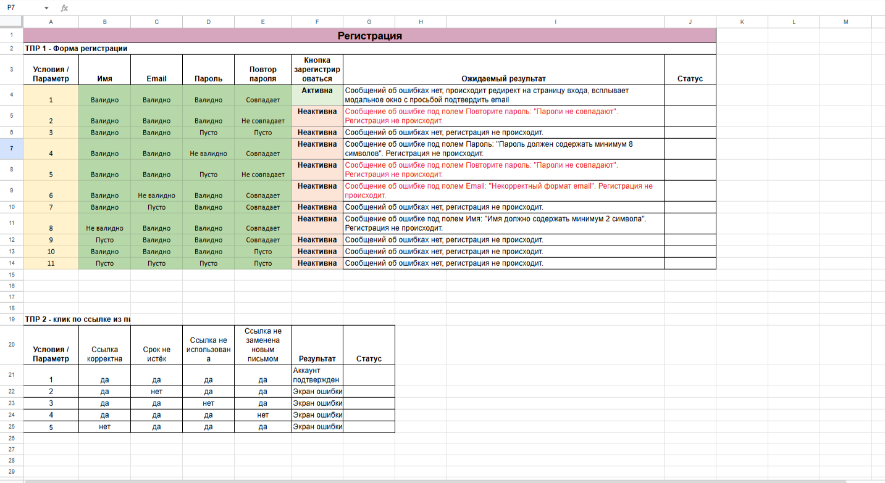
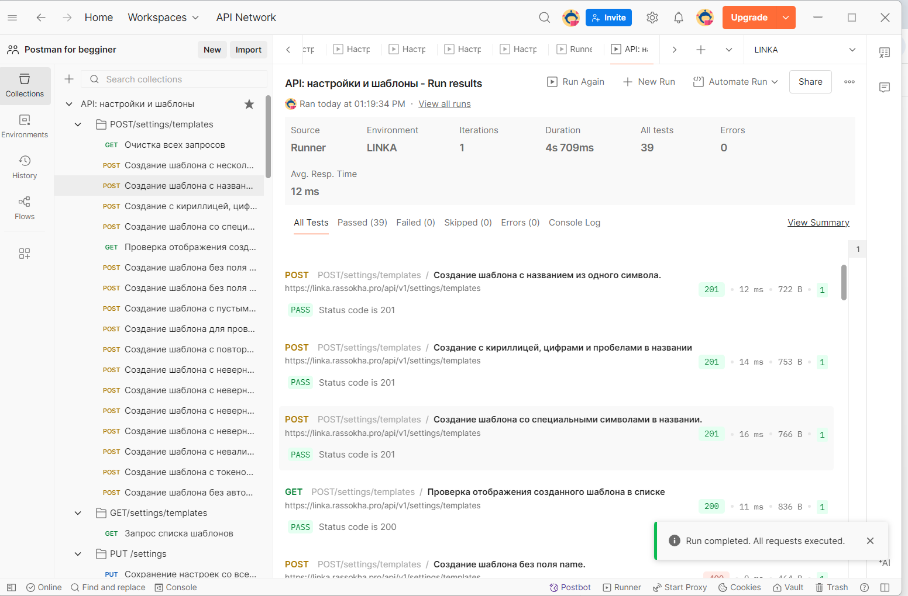
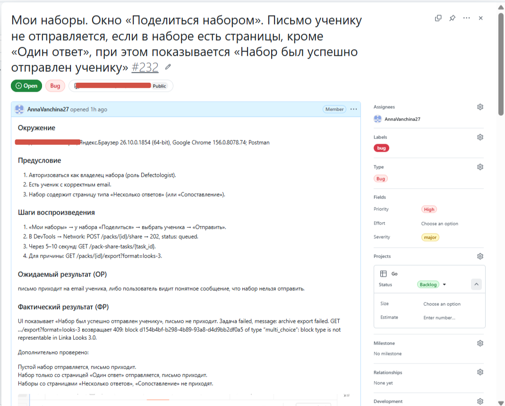

# LINKA: тестирование образовательной платформы

Проект «Яндекс Мастерской»: работа в команде над реальным продуктом **LINKA** — веб-платформой, где дефектологи создают наборы учебных заданий, хранят их в библиотеке и отправляют ученикам. Проект некоммерческий, заказчик — НКО.

**Роль:** QA Engineer (функциональное тестирование web + API). В рамках проекта неформально координировала команду тестирования из 12 человек.

## Коротко в цифрах

| | |
|---|---|
| Команда тестирования | 12 человек |
| Написала и прошла проверок лично | около 400 |
| Заведено багов | 14 (3 закрыты по решению ПМ) |
| Критичный дефект | #232: письмо ученику не уходит при сообщении об успехе |
| Окружение | Яндекс Браузер и Google Chrome на Windows 11, стенд разработки |

## Что я делала

- **Анализ требований и подготовка тестовых данных.** Из OpenAPI выписала ограничения полей, составила таблицу реализованных и нереализованных эндпоинтов, сопоставила их с кодом фронтенда.
- **Тест-дизайн.** Классы эквивалентности и граничные значения для полей регистрации (email, имя, пароль), таблицы принятия решений для формы регистрации и подтверждения email по ссылке из письма.
- **Функциональное тестирование веб-интерфейса** по чек-листу в Google Sheets, включая вход через Яндекс ID. Кроссбраузерная проверка, разные разрешения экрана.
- **API-тестирование в Postman.** Проверки статус-кодов, сквозные сценарии (E2E), запуск через Collection Runner с отдельным окружением.
- **Локализация дефектов.** Анализ запросов в DevTools (Network), проверка асинхронных задач и ответов сервера, поиск причины на стороне API.
- **Проверки в базе данных.** SQL-запросы к PostgreSQL (DBeaver, psql), чтобы подтвердить состояние данных после действий в интерфейсе и через API.
- **Баг-репорты в GitHub Issues** в формате «Где. Что. Когда» с окружением, шагами, ОР/ФР, приоритетом и серьёзностью.
- **Ретест исправлений** на стенде и закрытие багов после подтверждения исправления.
- **Отчётность для ПМ:** сводки о покрытии веба и бэкенда, результаты по багам. Показ результатов заказчику, замечаний с его стороны не было.

## Тест-дизайн

### Валидация email при регистрации

Таблица проверок по классам эквивалентности и граничным значениям: длина 0–5, 6–254 и 255+ символов, допустимые и недопустимые спецсимволы, точки и дефисы в разных позициях, отсутствие `@`, домена или локальной части. Для каждой проверки: тестовые данные, пояснение со ссылкой на RFC, статус в двух браузерах и ссылка на баг-репорт.

**Найденные дефекты:** система принимала email длиной 255+ символов и email с дефисом перед адресом; в домене допускалась кириллица ([#233](https://github.com/Linka-masterskaya/Web/issues/233), исправлен и перепроверен на стенде).



### Таблицы принятия решений (регистрация)

- **ТПР 1.** Форма регистрации: комбинации состояний полей «Имя», «Email», «Пароль», «Повтор пароля» (валидно / невалидно / пусто), состояние кнопки «Зарегистрироваться» и ожидаемые сообщения об ошибках.
- **ТПР 2.** Переход по ссылке из письма: ссылка корректна, срок не истёк, ссылка не использована и не заменена новым письмом.



## API-тестирование (Postman)

Подробное описание, коллекции и инструкция по запуску: [postman/README.md](postman/README.md).

| Коллекция | Что проверяется | Результат прогона |
|---|---|---|
| API: настройки и шаблоны | `/settings` и `/settings/templates`: 39 запросов, валидные и невалидные данные, типы полей, дубли, авторизация, сквозной сценарий «создать → найти в списке → удалить → убедиться, что удалён» | 39 из 39 тестов пройдены |
| Публикация набора | Создание папки в библиотеке и в «Моих наборах», создание набора, публикация в папку библиотеки, повторная публикация в другую папку, снятие с публикации, публикация в несуществующую папку | 8 из 8 тестов пройдены |

  

## Найденные дефекты

| Баг | Суть | Приоритет / серьёзность |
|---|---|---|
| [#232](https://github.com/Linka-masterskaya/zip-backend/issues/232) | Письмо ученику не уходит для наборов со страницами «Несколько ответов» и «Сопоставление», интерфейс при этом сообщает об успехе | High / major |
| [#233](https://github.com/Linka-masterskaya/Web/issues/233) | Поле Email принимает кириллицу в домене с латинской зоной, хотя в другом случае отклоняет | Medium / minor |
| [#238](https://github.com/Linka-masterskaya/zip-backend/issues/238) | `POST /auth/register`: правило для поля `name` не совпадает с `display_name` в `PATCH /profile/me` | см. issue |
| [#241](https://github.com/Linka-masterskaya/zip-backend/issues/241) | Пароль из одних пробелов принимается системой | см. issue |

### Пример баг-репорта: #232

**Мои наборы. Окно «Поделиться набором». Письмо ученику не отправляется, если в наборе есть страницы, кроме «Один ответ», при этом показывается «Набор был успешно отправлен ученику».**

Priority: High · Severity: Major

- `POST /packs/{id}/share` возвращает 202 и статус `queued`, интерфейс сообщает об успешной отправке.
- Фоновая задача `GET /pack-share-tasks/{task_id}` завершается со статусом `failed`: archive export failed.
- Причина: `GET /packs/{id}/export?format=looks-3` отвечает 409, потому что блок типа `multi_choice` не поддерживается в формате экспорта.
- Проверено: пустой набор и набор только со страницами «Один ответ» отправляются, наборы со страницами «Несколько ответов» и «Сопоставление» — нет.



**Подтверждение в базе данных.** Запись задачи в таблице `pack_share_jobs` показала, что письмо не было отправлено:

```sql
SELECT * FROM pack_share_jobs
WHERE id = 'b8422485-0780-4453-b278-4e58ac612f3a';
```

- `status = failed`, `message = archive export failed`
- `last_error = [CONFLICT] block ... of type "multi_choice": block type is not representable in Linka Looks 3.0`
- `email_sent_at` пустое, значит письмо ученику не уходило, хотя интерфейс сообщил об успехе.

## Процесс

- Отчёты по покрытию веба и бэкенда для ПМ.
- Еженедельные созвоны с наставником в Яндекс Телемосте.
- Показ результатов заказчику, сейчас идёт ретест исправлений.

## Инструменты

Google Sheets (чек-листы, учёт проверок), GitHub Issues и Projects, Postman (коллекции, окружения, Collection Runner), Swagger/OpenAPI, PostgreSQL (DBeaver, psql), Chrome DevTools, Яндекс Браузер, Google Chrome.
