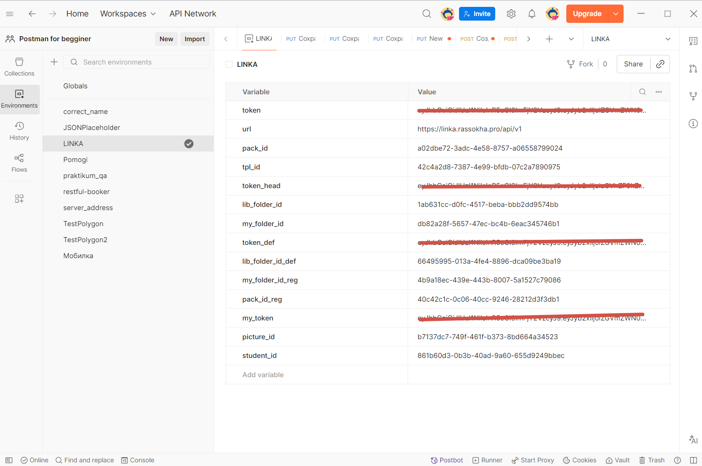
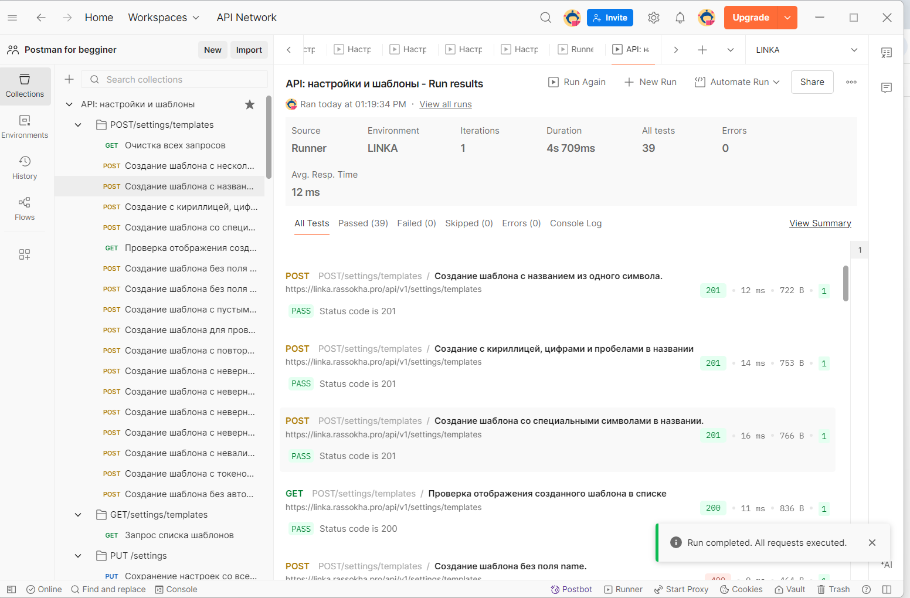

# Linka: API-тесты в Postman (настройки и шаблоны)

Коллекция Postman для проверки эндпоинтов `/settings` и `/settings/templates` продукта **Linka** (редактор наборов карточек для дефектологов). Учебный некоммерческий проект «Яндекс Мастерская».

Файл коллекции: [linka-api-settings-templates.postman_collection.json](linka-api-settings-templates.postman_collection.json)

## Что проверяется

| Папка | Запросов | Что покрыто |
|---|---|---|
| `POST/settings/templates` | 18 | Создание шаблона: валидные данные (несколько цветов, имя из одного символа, кириллица, цифры и пробелы, спецсимволы), отсутствие `name` и `body`, пустое тело, неверные типы полей, невалидный JSON, дубль имени (409), авторизация (401) |
| `GET/settings/templates` | 1 | Получение списка шаблонов |
| `PUT /settings` | 12 | Сохранение настроек: все поля, несколько цветов, полная замена, неверные типы (`border_width`, `colors`, строковые поля), неизвестное поле, невалидный JSON, авторизация (401) |
| `DELETE settings/templates` | 8 | Сквозной сценарий жизненного цикла шаблона и негативные проверки удаления |

Всего 39 запросов. Ожидаемые коды ответов: 200, 201, 204, 400, 401, 404, 409.

### Сквозной сценарий (папка `DELETE settings/templates`)

1. Создание шаблона (201), `id` сохраняется в переменную `tpl_id`.
2. Шаблон есть в списке.
3. Удаление шаблона (204).
4. Шаблона нет в списке.
5. Дополнительно: удаление с невалидным ID (400), несуществующего (404), повторное удаление (404), удаление без авторизации (401).

## Переменные окружения

Файл окружения в репозиторий не добавлен, так как значения содержат токены. Для этой коллекции нужны три переменные:

| Переменная | Что это |
|---|---|
| `url` | Адрес API стенда (`https://linka.rassokha.pro/api/v1`) |
| `token` | Bearer-токен тестового пользователя |
| `tpl_id` | ID созданного шаблона, заполняется скриптами при прогоне |

В моём окружении есть и другие переменные (для других коллекций), для этой нужны только три.

## Как запустить

1. Импортировать файл коллекции в Postman и создать окружение с переменными из таблицы выше.
2. Заполнить `url` и `token`. `tpl_id` заполняется скриптами.
3. Запустить коллекцию через **Runner** в том порядке, в котором запросы стоят в папках.

> Первый запрос папки `POST/settings/templates` («Очистка всех запросов») удаляет **все** шаблоны пользователя, чей токен подставлен. Используйте только тестовый аккаунт.
> Токены в репозиторий не добавлять.

## Результат прогона

Прогон всей коллекции через Runner: **39 из 39 тестов пройдены**, ошибок нет.

## Мой вклад

Коллекция командная. Мой вклад:

- сквозной сценарий жизненного цикла шаблона (создание, проверка в списке, удаление, проверка удаления);
- сохранение `id` в переменную `tpl_id` и проверки по ней;
- исправление тел и заголовков запросов, чтобы негативные проверки падали по нужной причине;
- настройка запуска в Runner и разбор падений прогона.
